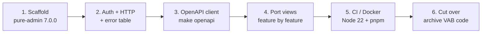

# Frontend migration: VAB admin-plus → vue-pure-admin

Investigation result and migration plan for moving `pager-frontend` off the VAB (vue-admin-beautiful
*admin-plus*) template onto [vue-pure-admin](https://github.com/pure-admin/vue-pure-admin).

- **Investigated on:** 2026-10-18, against `pager-frontend` branch `develop` (commit `d53ac31`) and
  `pager-backend` commit `a4e4439` ("Migrate to Spring 3").
- **Verdict:** the migration is **feasible**. It is a re-scaffold plus a port of the application
  layer, not an in-place library swap. The Pager-specific code is small and cleanly separated from
  the VAB shell, and no VAB capability used by the app is missing from pure-admin.
- **Constraint:** Pager is **not released**, so no backward-compatibility obligation exists. The
  migration targets the **latest** pure-admin release and the Node / tooling versions it requires;
  legacy pins are not kept for compatibility.

## 1. Current state of `pager-frontend`

### 1.1 Stack

| Aspect | Current value | Evidence |
|---|---|---|
| Build | Vue CLI 4.5, webpack 4, `vue.config.js`, npm | [package.json](/source/pager-frontend/package.json), [vue.config.js](/source/pager-frontend/vue.config.js) |
| Runtime image | `node:16` build stage, Python `http.server` serving `dist/` | [Dockerfile](/source/pager-frontend/Dockerfile) |
| Language | JavaScript only (0 `.ts` files) | `find src -name '*.ts'` |
| Framework | Vue 3.2, Vuex 4, vue-router 4 (hash mode), vue-i18n 9 | [package.json](/source/pager-frontend/package.json) |
| UI kit | Element Plus **1.2.0-beta.6**, `@element-plus/icons` 0.0.11 | [package.json](/source/pager-frontend/package.json) |
| Template layer | `src/vab/` (59 files: layouts, 24 global components, plugins, SCSS themes) | [src/vab/](/source/pager-frontend/src/vab/) |
| Layout in use | `horizontal`, theme `blue-black`, tabs on, theme/notice/search/full-screen off | [theme.config.js](/source/pager-frontend/src/config/theme.config.js) |
| API client | 18 hand-written axios modules over a shared instance | [src/api/](/source/pager-frontend/src/api/), [request.js](/source/pager-frontend/src/utils/request.js) |

> **Discrepancy found:** the repository `README.md` and `CLAUDE.md` describe an OpenAPI-generated
> client regenerated with `make openapi`. Neither the client nor the Makefile target exists on
> `develop`; all API modules are hand-written. The backend does ship `springdoc-openapi` 2.8.6
> ([build.gradle.kts](/source/pager-backend/build.gradle.kts)), so a generated client can be
> introduced as part of this migration (see §4 step 3).

### 1.2 Application surface (what must be ported)

| Area | Files | Lines | Notes |
|---|---|---|---|
| Views (`src/views/`) | 43 `.vue` | ≈ 7,800 | 35 use `defineComponent` + `setup()`, 4 Options API, 4 empty/unrouted |
| Real API modules | 13 | small | `project`, `article`, `articleList`, `template`, `navigation`, `user`, `userManagement`, `roleManagement`, `accessKey`, `systemLog`, `publicKey`, `refreshToken`, `router` |
| Pager-owned store module | 1 | 40 | [templateClipboard.js](/source/pager-frontend/src/store/modules/templateClipboard.js) |
| Error-code table | 1 | 70 | [errorMessage.config.js](/source/pager-frontend/src/config/errorMessage.config.js); mirrors [/doc/backend_error/](/doc/backend_error/README.md) |
| Routes | 1 | 230 | [router/index.js](/source/pager-frontend/src/router/index.js): 5 constant + 1 root + 9 project-scoped async routes |

Routed screens: login, register, callback, 403, 404, home (projects / access keys / users cards),
project detail, add project, articles, edit article, article lists, edit article list, template
directory, template editor, navigation.

### 1.3 Coupling to VAB measured in `src/views/`

| VAB dependency | Occurrences | Replacement in pure-admin |
|---|---|---|
| `<vab-icon icon="…">` (RemixIcon names via `vab-icons`) | 45 | `IconifyIconOffline` / `IconifyIconOnline` with `ri:` prefix; names map 1:1 |
| `<vab-card>` | 28 | `el-card` |
| `$baseMessage` / `$baseConfirm` / `$baseLoading` / `$baseNotify` on `proxy` | 26 / 6 / 2 / 1 | `message()` from `@/utils/message`, `ElMessageBox`, `ElLoading`, `ElNotification` |
| `<vab-query-form>` + left / right / top panels | 7 + 12 | `el-row` / `el-col` or PureTable toolbar slot |
| `<vab-chart>` (echarts wrapper) | 6 (5 in unrouted demo components) | `useECharts` from `@pureadmin/utils` |
| `<vab-count>` | 4 (unrouted demo) | `ReNormalCountTo` |
| `<vab-upload>`, `<vab-quill>`, `<vab-cropper>`, `<vab-avatar-list>` | 1 each | `el-upload`, `@vueup/vue-quill`, `ReCropper` (cropperjs), plain markup |
| `$base-*` SCSS variables injected by sass `additionalData` | 10 views, 9 variables | SCSS shim with the same names via Vite `css.preprocessorOptions` |
| Vuex `tabs/*` (`delVisitedRoute`, `changeTabsMeta`, `visitedRoutes`) | 8 | `useMultiTagsStoreHook().handleTags(...)` |
| Vuex `user/*` (`token`, `avatar`, `username`, `login`, `setToken`) | 8 | `useUserStoreHook()` + `getToken()` |
| Vuex `templateClipboard/*` | 4 | ported Pinia store |
| `translateTitle` (vue-i18n) | 2 | dropped, or `$t` on the `i18n` variant |

### 1.4 VAB-only code that is deleted, not ported

- **Licence / tamper checks shipped by VAB** in [vab.js](/source/pager-frontend/src/vab/plugins/vab.js),
  [support.js](/source/pager-frontend/src/vab/plugins/support.js) and
  [directive.js](/source/pager-frontend/src/vab/plugins/directive.js): in non-development builds the
  app's global properties are set to `null` when the `vab-icons` dependency or `VUE_APP_SECRET_KEY`
  is absent. `vue.config.js` also requires `vue-plugin-rely`, an undeclared transitive dependency of
  `vab-icons`. pure-admin is MIT-licensed and has no such checks.
- Mock API modules with no backend endpoint: `api/table.js`, `goods.js`, `area.js`, `workflow.js`,
  `remixIcon.js`, `refreshToken.js` (`/refreshToken`, `/expireToken`), `router.js` (`/router/getList`).
- Unrouted dashboard demo components: `views/index/dashboard.vue`, `components/Order.vue`,
  `Target.vue`, `Trend.vue`, `Rank.vue`, `Plan.vue`, `Branch.vue`, `Tabs.vue`, `AccessKey.vue`.
- Unused `src/extra/` components: `VabAnchor`, `VabDialog`, `VabFormTable`, `VabIconSelector`,
  `VabJsonViewer`.
- Social login (`utils/social.js`, `views/callback`), RSA login encryption (`utils/encrypt.js`,
  `loginRSA: false`), the VAB demo i18n dictionary (`i18n/zh.js`, `en.js`), `plopfile.js` and
  `vab-templates-vue3`, PWA service worker registration.

### 1.5 Backend auth contract (unchanged by this migration unless step 2b is taken)

| Endpoint | Response | Source |
|---|---|---|
| `POST /v1/user/login` | `{ identifier, token }` — a JWT valid for 24 h | [UserLoginResponse.kt](/source/pager-backend/app/cms/src/main/kotlin/com/xwkj/cms/response/UserLoginResponse.kt), [JwtComponent.kt](/source/pager-backend/domain/src/main/kotlin/com/xwkj/pager/domain/component/JwtComponent.kt) |
| `GET /v1/user/me` | `{ username, avatar, roles, permissions }` | [UserGetInfoResponse.kt](/source/pager-backend/app/cms/src/main/kotlin/com/xwkj/cms/response/UserGetInfoResponse.kt) |
| refresh token | **does not exist** | — |

Requests send `Authorization: Bearer {token}`. Business errors arrive as `errorCode` in the body
and are mapped to messages by `errorMessage.config.js`; HTTP 401 redirects to `/login`, 403 to
`/403`. The frontend's 402 → refresh flow in `request.js` is VAB scaffolding and has never been
backed by the server.

## 2. Target: vue-pure-admin 7.0.0

Facts fetched from the pure-admin repositories on 2026-10-18:

| Edition | Version | Node | pnpm | Notes |
|---|---|---|---|---|
| `vue-pure-admin` `main` (full) | **7.0.0** (2026-04-07) | ≥ 22.22.1 | ≥ 11 | Vite 8 (Rolldown + Oxc), TypeScript 6, vue-router 5.4, Pinia 4, Element Plus 2.14, Tailwind 4, vue-i18n 11, axios 1.18 |
| `pure-admin-thin` `main` / `i18n` | 6.2.0 (2025-10-30) | ^20.19 or ≥ 22.13 | ≥ 9 | Lags the full edition; vue-router 4.6, Pinia 3, Vite 7, TS 5.9 |

**Decision: scaffold from `vue-pure-admin` 7.0.0 (full edition) and delete the demo pages.**
The thin editions have not received the 7.0 changes, and starting from 7.0.0 avoids a second
upgrade immediately after the port. A JavaScript edition is not offered; the new scaffolding is
TypeScript.

Implications accepted as work items, not as reasons to pick an older base:

- Node 22.22+ and pnpm 11 in the Dockerfile, Jenkins agent and developer setup.
- vue-router 5: navigation guards `return` a location instead of calling `next()`.
- Vite 8: `require.context` → `import.meta.glob`, `process.env.VUE_APP_*` → `import.meta.env.VITE_*`,
  `public/index.html` → root `index.html`, svg-sprite-loader → Iconify.
- Element Plus 2.14 (from 1.2 beta): 25 `type="text"` buttons → `link`, 2 `size="mini"` → `small`,
  5 files importing `@element-plus/icons` → `@element-plus/icons-vue`, locale imports from
  `element-plus/es/locale/lang/*`.

## 3. Mapping tables

### 3.1 Route meta

| VAB `meta` field | pure-admin `meta` field |
|---|---|
| `title` | `title` |
| `icon: 'home-2-line'` | `icon: 'ri:home-2-line'` |
| `hidden: true` | `showLink: false` |
| `noKeepAlive: true` | `keepAlive: false` (default is `false`) |
| `noClosable: true` | `fixedTag: true` |
| `breadcrumbHidden`, `noColumn`, `dynamicNewTab` | dropped (layout-specific to VAB) |
| `guard: { role, permission, mode }` | `roles: [...]` for pages, `auths: [...]` for buttons |
| `activeMenu` | `activePath` |

Route definitions move from one `router/index.js` into `src/router/modules/*.ts`, one module per
area (`home.ts`, `project.ts`), collected by pure-admin's `import.meta.glob`. The error pages,
login and register go to `modules/remaining.ts`. Hash mode is replaced by history mode
(`VITE_ROUTER_HISTORY=h5`), which is possible because nothing is deployed yet.

### 3.2 Store

| Vuex module | Fate |
|---|---|
| `user` | replaced by pure-admin `useUserStore` (`username`, `avatar`, `roles`, `permissions`) |
| `tabs` | replaced by `useMultiTagsStore` |
| `routes`, `acl` | replaced by `usePermissionStore` + `meta.roles` / `hasPerms` |
| `settings`, `errorLog` | replaced by `useAppStore` / `useSettingStore`; error-log drawer dropped |
| `templateClipboard` | **ported** as `src/store/modules/templateClipboard.ts` (`defineStore('pager-template-clipboard', …)`) |

### 3.3 Permissions

VAB `v-permissions` + `hasPermission({ role, permission, mode })` become pure-admin `v-auth` /
`hasPerms` on the `permissions` array from `GET /v1/user/me`, and `meta.roles` on routes using the
`UserRole` values (`OWNER` > `ADMIN` > `DEVELOPER` > `CUSTOMER`). Permission values are the
`UserPermission` constants documented under [/doc/permission/](/doc/permission/README.md).

### 3.4 HTTP layer

pure-admin's `PureHttp` (`src/utils/http/index.ts`) expects `DataInfo { accessToken, expires,
refreshToken, … }` stored in the `authorized-token` cookie and performs a client-side expiry check
before each request. Two ways to reconcile with the backend contract in §1.5:

| Option | Frontend | Backend | Recommendation |
|---|---|---|---|
| **2a. Client-side expiry, no refresh** | on login set `expires = now + 24 h`, `refreshToken = ''`; delete the refresh branch | none | smallest change |
| **2b. Real refresh endpoint** | keep `PureHttp` as shipped | add `POST /v1/user/refresh` returning `{ token, expires, refreshToken }` and extend `UserLoginResponse` with `expires` / `refreshToken` | **chosen** — the project is unreleased, so the backend contract is still free to change, and the stock pure-admin auth flow is kept intact |

Either way the response interceptor is extended with the behaviour of the current `request.js`:
HTTP 401 → `removeToken()` + `/login`, 403 → `/error/403`, body `errorCode` → message via the
ported error table, which must stay in sync with [/doc/backend_error/](/doc/backend_error/README.md).

## 4. Migration steps

| Step | Scope | Deliverable |
|---|---|---|
| 1. Scaffold | New `pager-front` tree from `vue-pure-admin` 7.0.0: remove demo views, mock server and CDN mode; set `platform-config.json` (title `Pager Cms`, layout `horizontal`, `MultiTagsCache`, dark mode on); add `.env.development` / `.env.staging` / `.env.production` with `VITE_API_BASE` from the current `VUE_APP_BASE_API` values; `$base-*` SCSS shim | app boots to the pure-admin login page against `beta-api.pagercms.com` |
| 2. Auth + HTTP | `api/user.ts`, `utils/auth.ts` adapted to §3.4 option 2b; backend `POST /v1/user/refresh` + DTO changes (own BE plan); error-code table ported to `utils/errorMessage.ts`; `v-auth` wired to `permissions`; `meta.roles` on project routes | login, `/me`, logout, 401/403 handling, token refresh verified |
| 3. OpenAPI client | `make openapi` target running `openapi-typescript` + `openapi-fetch` (or `@hey-api/openapi-ts`) against `http://localhost:8080/v3/api-docs`; generated client under `src/api/generated/`; hand-written modules replaced by thin wrappers | the README / CLAUDE.md claim becomes true |
| 4. Port views | One PR per feature in this order: home cards → project (detail, add, deploy, upload zip) → templates (directory, editor) → articles (lists, items, dialogs) → navigation → settings (users, roles, logs, personal centre) → login / register / error pages. Each view rewritten as `<script setup lang="ts">`, with the replacements in §1.3 | feature parity screen by screen; the [spec index](/doc/spec/README.md) is the acceptance checklist |
| 5. CI / Docker | `Dockerfile`: `node:22` build stage with `corepack enable && pnpm install --frozen-lockfile && pnpm build`; serve `dist/` from nginx instead of `python -m http.server`; Jenkinsfile and `Makefile` updated for the new image | staging image published from the new tree |
| 6. Cut over | `develop` switched to the new tree; VAB tree kept under a `legacy/vab` tag only | old scaffold removed |

Each step is implemented as a numbered plan in the next in-progress release folder, using the
umbrella + `-stepN` pattern. Backend changes in step 2 are a separate `-be` plan with the DTO and
endpoint definitions.

## 5. Effort and risks

| Item | Estimate / note |
|---|---|
| Scaffold, auth, HTTP, OpenAPI (steps 1–3) | ≈ 1 engineer-week |
| View port (step 4, 43 files) | ≈ 1–2 engineer-weeks; heaviest are `template/directory.vue` (469 lines), `article/articleList.vue` (422), `template/editor.vue` (293, `vue-prism-editor` kept as is) |
| CI / Docker / cut-over (steps 5–6) | ≈ 2 days |
| **Risk: `vue-pure-admin` 7.x moves fast** | pin the exact 7.0.0 tag when scaffolding; later upstream changes are not auto-merged |
| **Risk: Element Plus beta → 2.14 behaviour drift** | mostly mechanical (§2); `el-table` / `el-pagination` props verified per screen during step 4 |
| **Risk: vue-router 5 guard semantics** | only pure-admin's own guard is affected; Pager adds no custom guards |
| **Risk: i18n** | the current UI is effectively Chinese-only (2 `translateTitle` calls). The full 7.0.0 edition keeps vue-i18n available, so bilingual copy can be added later without re-scaffolding |

## 6. Sources

- [pager-frontend](/source/pager-frontend/) `develop` @ `d53ac31`, [pager-backend](/source/pager-backend/) @ `a4e4439`
- [vue-pure-admin `package.json` (main)](https://github.com/pure-admin/vue-pure-admin/blob/main/package.json) and [release v7.0.0](https://github.com/pure-admin/vue-pure-admin/releases/tag/v7.0.0)
- [pure-admin-thin `package.json` (main)](https://github.com/pure-admin/pure-admin-thin/blob/main/package.json), branches `main` and `i18n`
- pure-admin-thin `src/utils/http/index.ts`, `src/utils/auth.ts`, `src/store/modules/user.ts`, `src/router/index.ts` (auth / routing model described in §3)
